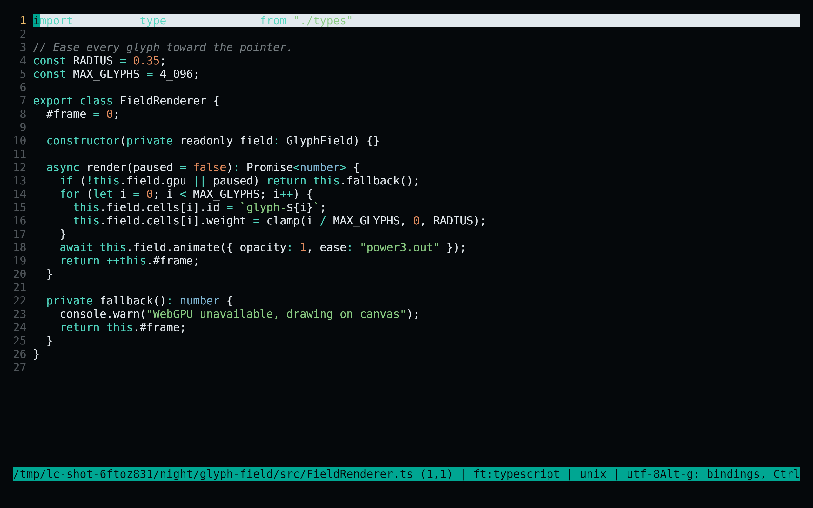
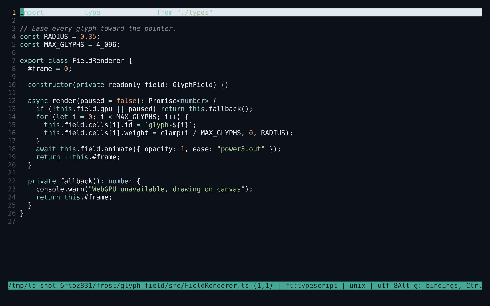
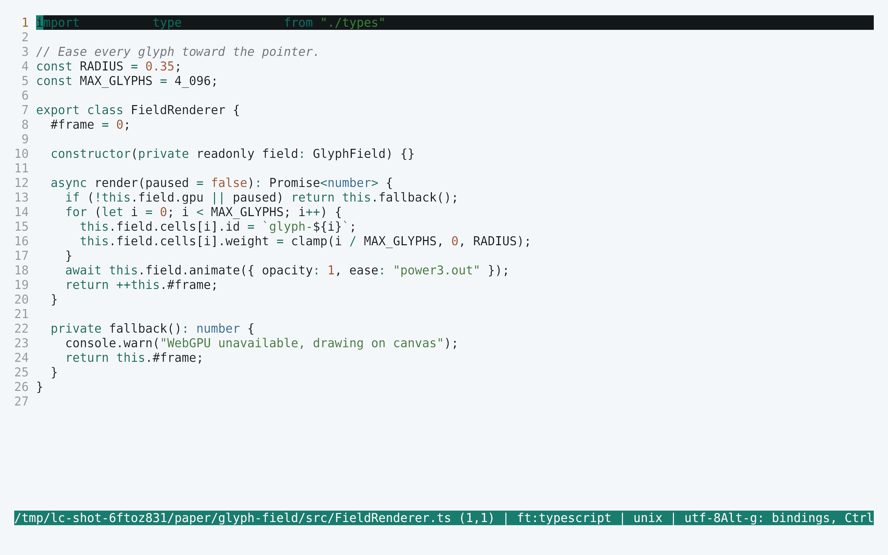
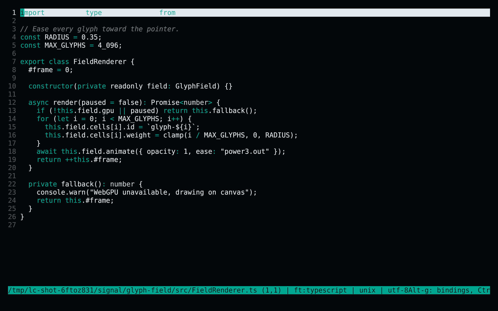

<!-- living-code-readme:1 -->
# 🔬 Living Code for micro

**Calm slate. Living color.** Living Code for micro: native color-link schemes for syntax groups, editor chrome, selections, diagnostics and search matches.

[Installation](#installation) · [Flavors](#flavors) · [Configuration](#configuration) · [All ports](https://github.com/living-code-theme)

## Previews

<table data-lc-flavors>
<tr>
<td width="50%" valign="top">
<strong>Night</strong><br><sub>Dark · full palette</sub><br><br>
<a href="images/night.png"></a>
</td>
<td width="50%" valign="top">
<strong>Frost</strong><br><sub>Dark · softer chroma</sub><br><br>
<a href="images/frost.png"></a>
</td>
</tr>
<tr>
<td width="50%" valign="top">
<strong>Paper</strong><br><sub>Light · near-white slate</sub><br><br>
<a href="images/paper.png"></a>
</td>
<td width="50%" valign="top">
<strong>Signal</strong><br><sub>Dark · teal accent</sub><br><br>
<a href="images/signal.png"></a>
</td>
</tr>
</table>

Select any preview to view the image at full size.

## Installation

```sh
flavor=night # night, frost, paper, or signal
curl -fsSL --create-dirs -o "${XDG_CONFIG_HOME:-$HOME/.config}/micro/colorschemes/living-code-$flavor.micro" "https://raw.githubusercontent.com/living-code-theme/micro/main/themes/living-code-$flavor.micro"
```

Open micro, press **Ctrl+E**, and run `set colorscheme living-code-night` (or your selected flavor). If truecolor is not detected, run `set truecolor on` too. When launching micro with `-config-dir`, use that directory’s `colorschemes/` instead of the default above.

## Flavors

Expand a flavor for its full-size preview and activation instructions.

<details data-lc-flavor="night">
<summary><strong>Night</strong> · Dark · full palette</summary>

<p><a href="images/night.png"></a></p>

Press **Ctrl+E** and run `set colorscheme living-code-night`.

</details>

<details data-lc-flavor="frost">
<summary><strong>Frost</strong> · Dark · softer chroma</summary>

<p><a href="images/frost.png"></a></p>

Press **Ctrl+E** and run `set colorscheme living-code-frost`.

</details>

<details data-lc-flavor="paper">
<summary><strong>Paper</strong> · Light · near-white slate</summary>

<p><a href="images/paper.png"></a></p>

Press **Ctrl+E** and run `set colorscheme living-code-paper`.

</details>

<details data-lc-flavor="signal">
<summary><strong>Signal</strong> · Dark · teal accent</summary>

<p><a href="images/signal.png"></a></p>

Press **Ctrl+E** and run `set colorscheme living-code-signal`.

</details>

## Configuration

The `.micro` files contain only native `color-link` directives. Default body colors, selected text, status lines, tabs, cursor line, search and trailing whitespace are explicitly configured. Built-in syntax subgroups preserve string/number/boolean and operator distinctions. `identifier.class` is used by some micro grammars for functions as well as classes, so it follows the function role.

## Compatibility

For micro’s documented color-link format, with truecolor enabled for exact hex colors. In reduced-color terminals micro approximates the palette. Highlight precision depends on the filetype’s built-in syntax rules: the colorscheme does not install new grammars. Tests validate directive grammar, native group names and semantic colors.

Previews are captured programmatically from the actual application in an isolated profile. See [`capture/app.py`](capture/app.py) for the app-owned recipe and [`images/capture.json`](images/capture.json) for runtime, palette and image provenance. No mock interface is drawn.

## Contributing

Found a problem? [Open an issue](https://github.com/living-code-theme/micro/issues/new/choose) with the app version, the flavor and a screenshot. Want Living Code somewhere else? [Request a port](https://github.com/living-code-theme/core/issues/new?template=port-request.yml).

Pull requests are welcome. Keep this README, `port.json` and `images/` in sync, and use real screenshots of the app, never mockups.

🦎 **One chameleon, many habitats.** Part of [Living Code](https://github.com/living-code-theme).

## License

[MIT](LICENSE) © Elliot Luque
